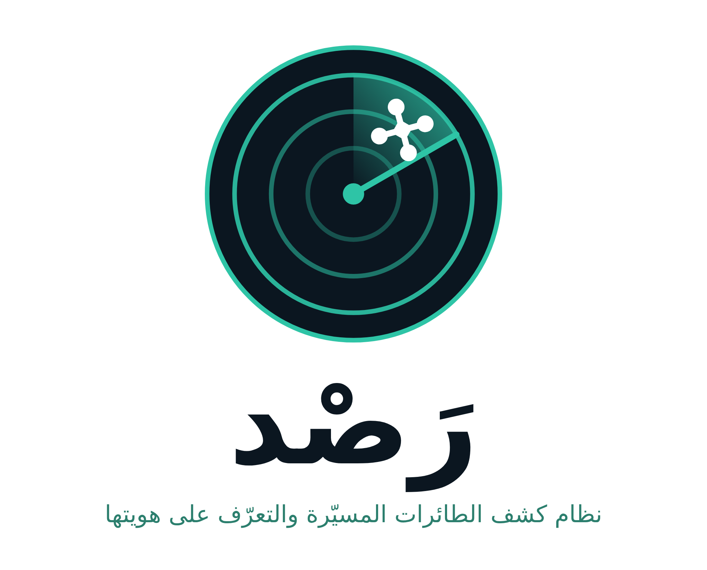

<div dir="rtl">

<p align="center"></p>

# رصد: نظام كشف الطائرات المسيّرة والتعرّف على هويتها

نظام محمول منخفض التكلفة يكتشف الطائرات المسيّرة ويحدد هويتها ونوعها. يجمع ثلاثة حساسات في جهاز واحد متصل بلابتوب، ويعرض النتيجة فوراً: **هدف تم التعرف عليه** أو **هدف لم يتم التعرف عليه**. يعمل بلا إنترنت، ويرصد ويراقب فقط.

مشروع تخرج لمتدربي تخصص الدعم الفني للحاسب الآلي، قسم الحاسب الآلي وتقنية المعلومات، الكلية التقنية والمعهد الصناعي الثانوي بظهران الجنوب.

## روابط المشروع

| الرابط | الوصف |
|---|---|
| [معاينة المشروع ثلاثية الأبعاد](https://claude.ai/artifact/C3QfTEFCNASa2KkKvkFcCX) | مجسّم تفاعلي لطاولة العرض، مع عرض موجّه خطوة خطوة |
| [لوحة العرض](https://claude.ai/artifact/MvfrCRtV8KDKgb3imn4ExN) | لوحة الرول أب ولوحة A4 وشعار المشروع |
| [أجزاء المشروع (PDF)](docs/rasd-parts.pdf) | القطع بالصور، ومخطط التوصيل |
| فيديو المشروع | يُضاف بعد التصوير |

## كيف يعمل

1. **رصد:** رادار دوّار (حساس HC-SR04 على سيرفو) يرصد الهدف ويحدد زاويته ومسافته.
2. **تتبّع:** كاميرا ويب على قاعدة متحركة تلتفت إلى زاوية الهدف وتتبعه.
3. **تعرّف:** نموذج ذكاء اصطناعي يصنّف الطائرة (شحن أم تصوير)، ولوحة ESP32 تستقبل هويتها الرسمية عبر Remote ID.
4. **استجابة:** إذا وصلت الهوية خلال 10 ثوانٍ فالهدف معروف، وإلا يُطلق النظام إنذاراً ويسجل الحدث ويجهّز بلاغاً للجهة المختصة.

## محتويات المستودع

```
firmware/
  radar_camera_nano/radar_camera_nano.ino   كود Arduino Nano: الرادار وقاعدة الكاميرا
  remote_id_scanner/remote_id_scanner.ino   كود ESP32: استقبال Remote ID
laptop/
  usb_bridge.py       الجسر بين لوحات USB وخادم MQTT (لا يمرر إلا أوامر معرّفة مسبقاً)
  camera_tracker.py   توجيه الكاميرا لإبقاء الهدف في منتصف الصورة
docs/rasd-parts.pdf   أجزاء المشروع ومخطط التوصيل
```

## التشغيل على لابتوب العرض

1. ثبّت [Arduino IDE](https://www.arduino.cc/en/software) مع حزمة لوحات ESP32، ومكتبة NimBLE-Arduino.
2. ارفع `radar_camera_nano.ino` إلى الـ Nano، و`remote_id_scanner.ino` إلى ESP32 الأولى.
3. ثبّت [Mosquitto](https://mosquitto.org/download/) وPython، ثم:
   ```
   pip install pyserial paho-mqtt
   ```
4. وصّل اللوحات باللابتوب عبر موزّع USB، ثم شغّل:
   ```
   python laptop/usb_bridge.py
   python laptop/camera_tracker.py
   ```
5. افتح لوحة المراقبة في Node-RED، وافصل الـ WiFi قبل العرض.

**توصيل الـ Nano:** HC-SR04: Trig على D9 وEcho على D10. سيرفو الرادار D3، وسيرفو دوران الكاميرا D5، وسيرفو رفعها D6. السيرفوهات من مصدر 5V خارجي بأرضي مشترك مع الـ Nano.

## التقنيات المستخدمة

ESP32 · Arduino Nano · Bluetooth Low Energy · Remote ID (ASTM F3411) · Ultrasonic Radar · YOLO · Python · OpenCV · MQTT · Node-RED · SQLite

## فريق المشروع

| المتدرب | الجزء المسؤول عنه |
|---|---|
| سامي مسفر مسعود آل صالح الوادعي (قائد الفريق) | النظام كاملاً، والتنسيق، والعرض |
| ريان مبارك حسين آل صالح | الرادار والكاميرا المتحركة |
| محمد مشبب مسعود آل صالح الوادعي | Remote ID والدرون الافتراضي |
| يحي مسفر مسعود آل صالح الوادعي | الذكاء الاصطناعي ولوحة المراقبة |
| ناصر مهدي ناصر آل صالح | تجميع الجهاز والتوصيلات |

**مشرف المشروع:** المهندس عبدالله محمد الوادعي

## ضوابط المشروع

- النظام رصد سلبي: يستقبل ويراقب فقط، ولا يرسل أي إشارة نحو الطائرات ولا يشوّش عليها. اعتراض الطائرات من اختصاص الجهات الأمنية المخوّلة.
- الاختبار بدرون ألعاب أو مجسمات وطائرة افتراضية تبث Remote ID. تطيير درون حقيقي يحتاج تصريحاً من الهيئة العامة للطيران المدني.
- النظام معزول عن الإنترنت أثناء التشغيل.

</div>
